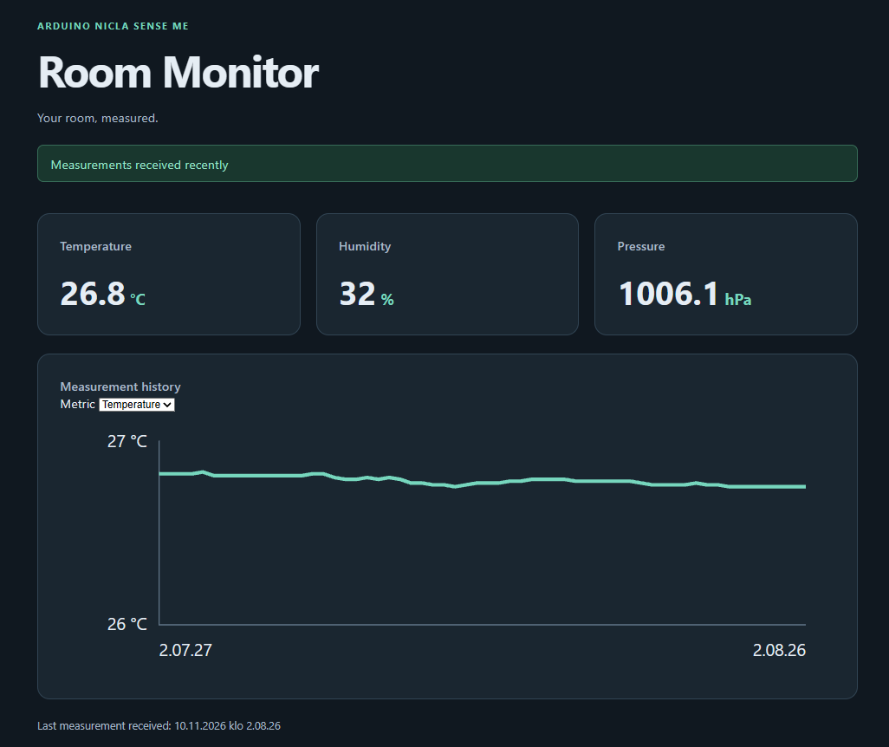

# Room Monitor

Room Monitor tracks indoor temperature, relative humidity, and atmospheric
pressure using an Arduino Nicla Sense ME. A Python reader stores measurements
in SQLite, and a React dashboard displays the latest readings and recent history.

## Features



- Newline-delimited JSON over USB serial
- Measurement validation and SQLite storage with UTC reception timestamps
- FastAPI endpoints for the latest measurement and up to 60 recent measurements
- React and TypeScript dashboard with automatically refreshed readings
- History chart with a selector for temperature, humidity, and pressure
- Warning when no measurements have arrived for more than 15 seconds


## Run locally on Windows

Run the serial reader and API from the repository root in separate terminals.
Run the dashboard in a third terminal.

### 1. Start the serial reader

Upload the sketch in `firmware/room_monitor` to your Nicla Sense ME. Connect the
board over USB and close the Arduino Serial Monitor before starting the reader.

```powershell
python -m venv .venv
.\.venv\Scripts\python.exe -m pip install -r requirements.txt
.\.venv\Scripts\python.exe serial_reader.py --port COM6
```

Replace `COM6` with your board's serial port. The reader saves measurements to
`measurements.sqlite3`.

### 2. Start the API

```powershell
.\.venv\Scripts\python.exe -m uvicorn api:app --reload
```

Open the [interactive API documentation](http://127.0.0.1:8000/docs) to try the
latest measurement and history endpoints.

### 3. Start the dashboard

From the repository root, run:

```powershell
cd frontend
npm.cmd ci
npm.cmd run dev
```

Open the address printed by Vite, usually [http://localhost:5173](http://localhost:5173).
The Vite development server forwards `/api` requests to FastAPI.

## Planned features

- Demo mode with sample data so the dashboard can be tried without hardware